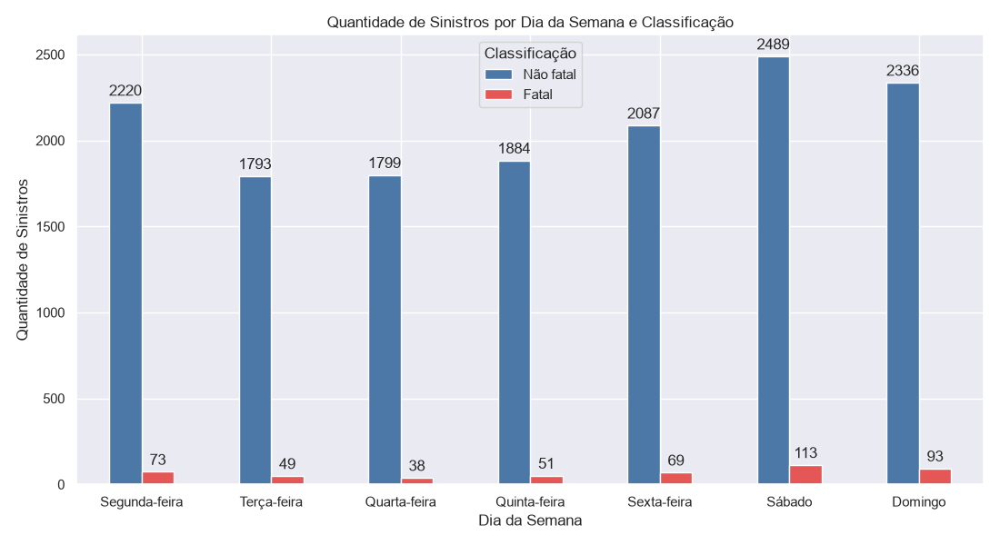
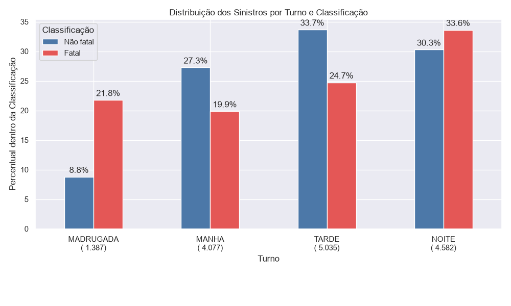
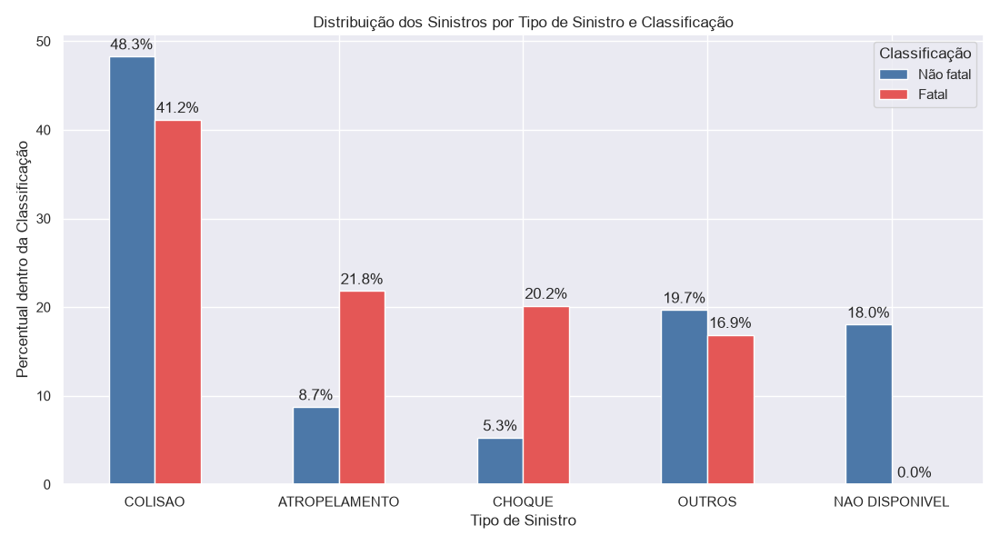
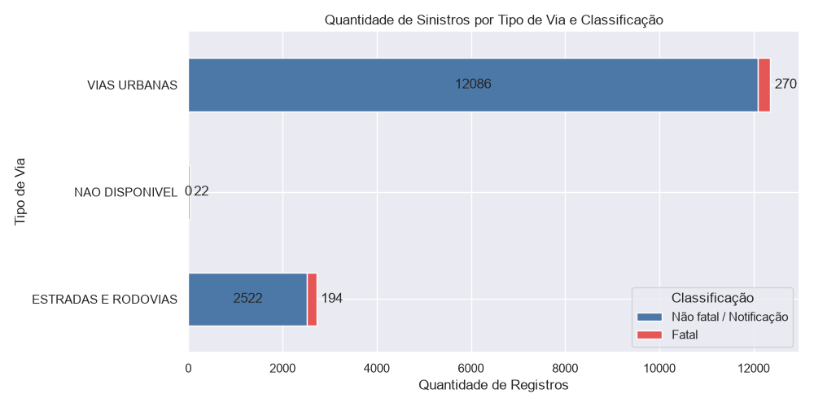
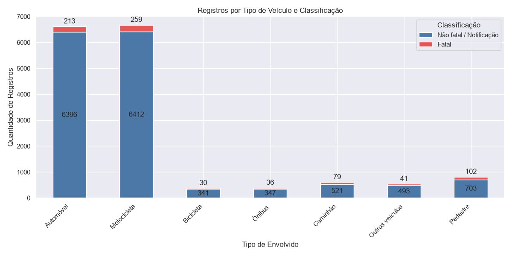
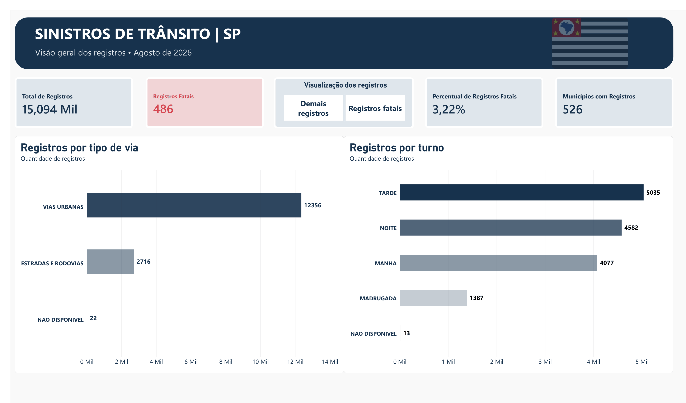
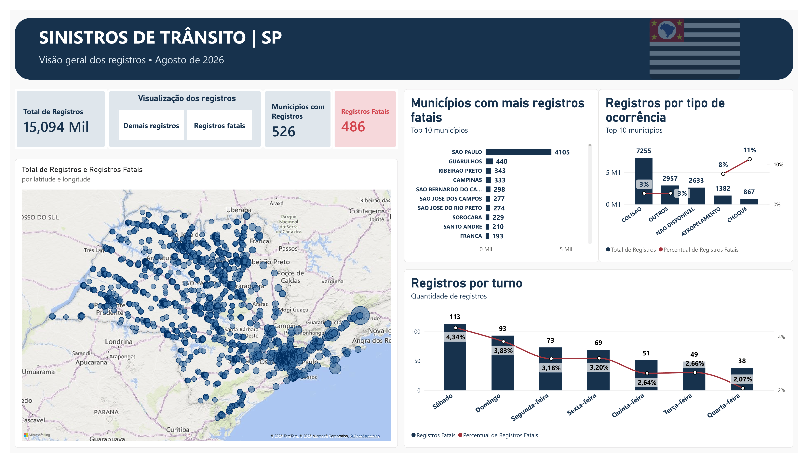

# Análise de Sinistros de Trânsito — São Paulo

Projeto de análise exploratória de dados e Business Intelligence com Python e Power BI, utilizando registros de sinistros de trânsito do estado de São Paulo referentes a agosto de 2026.

## Sobre o projeto

O objetivo é explorar a estrutura e a qualidade dos dados, investigar a distribuição dos registros por dia da semana, turno, município, tipo de via e tipo de ocorrência, além de comparar a quantidade de registros com a proporção daqueles classificados como fatais.

A partir dessa análise, foram desenvolvidas visualizações em Python e um dashboard interativo no Power BI, buscando transformar os dados em informações relevantes e documentar as limitações e inconsistências identificadas durante o processo.

## Tecnologias utilizadas

- **Python:** preparação dos dados e análise exploratória.
- **Pandas:** manipulação e transformação dos dados.
- **Matplotlib e Seaborn:** criação de visualizações.
- **Power BI:** modelagem de dados, medidas DAX e dashboard interativo.
- **Git e GitHub:** versionamento e documentação do projeto.

## Etapas do projeto

### 1. Análise exploratória de dados (EDA)

A etapa exploratória foi desenvolvida em Python, incluindo a inspeção das colunas, a análise de valores ausentes, a distribuição das categorias e a comparação dos registros por período, município, tipo de via e tipo de ocorrência.

Os resultados orientaram a seleção dos indicadores e das visualizações utilizadas no dashboard.

### 2. Visualizações em Python

Foram desenvolvidos gráficos para investigar padrões e comparar categorias. As visualizações serviram como apoio à interpretação dos dados e à definição das análises apresentadas no Power BI.

### 3. Business Intelligence com Power BI

O dashboard foi organizado em duas páginas:

**Página 1 — Visão geral**
- Total de registros.
- Registros classificados como fatais.
- Percentual de registros classificados como fatais.
- Distribuição por tipo de ocorrência, turno e tipo de via.

**Página 2 — Onde e quando?**
- Distribuição geográfica dos registros.
- Top 10 municípios com maior quantidade de registros.
- Comparações por dia da semana e turno.

## 📊 Principais resultados da análise exploratória

A análise exploratória foi realizada com o objetivo de compreender a distribuição dos sinistros de trânsito, identificar padrões temporais e geográficos e investigar a proporção de registros classificados como fatais.

### Indicadores gerais

| Indicador | Resultado |
|---|---:|
| Total de registros analisados | 15.094 |
| Registros classificados como fatais | 486 |
| Proporção de registros fatais | 3,22% |
| Ocorrências classificadas como colisão | 7.255 |
| Participação de colisões na base | 48,1% |

### 1. Distribuição de registros por dia da semana e classificação



A distribuição dos registros por dia da semana revelou uma concentração de ocorrências aos finais de semana. O sábado apresentou o maior volume, com 2.602 registros, seguido pelo domingo, com 2.429.

Em relação aos registros classificados como fatais, o sábado também apresentou o maior número absoluto, com 113 ocorrências, além da maior proporção entre os dias da semana, aproximadamente 4,34%.

A quarta-feira apresentou o menor volume de registros, com 1.837 ocorrências, e o menor número de registros classificados como fatais, com 38.

No total, sábado e domingo concentraram aproximadamente 33,3% dos registros analisados.


### 2. Distribuição por turno e classificação




Os turnos da tarde (5.035 registros) e da noite (4.582 registros) concentraram a maior quantidade de ocorrências.

Entretanto, ao analisar a proporção de registros classificados como fatais, a madrugada apresentou o maior percentual, aproximadamente 7,43%, desconsiderando a categoria sem classificação de turno.


### 3. Tipos de ocorrência




A variável tp_sinistro_primario identifica a classificação principal do sinistro de trânsito.

As categorias representam diferentes naturezas de ocorrência:

- **Colisão**: impacto entre veículos, incluindo colisões frontais, laterais, traseiras e transversais.

- **Choque**: impacto de um veículo contra objetos ou obstáculos, como postes e muros.

- **Atropelamento**: ocorrência envolvendo o impacto de um veículo contra um pedestre.

- **Outros**: categoria utilizada para registros classificados em tipos de ocorrência não apresentados individualmente nas demais categorias. A composição exata dessa categoria depende da definição do dicionário de dados do Infosiga.

- **Não disponível**: registros sem classificação disponível para o tipo de ocorrência.

A colisão foi a categoria predominante, representando a maior participação tanto entre os registros não fatais (48,3%) quanto entre os fatais (41,2%).
Ao comparar a distribuição dos tipos de ocorrência, observa-se que:

- Atropelamento: apresentou maior participação entre os registros fatais (21,8%) do que entre os não fatais (8,7%).

- Choque: também teve maior participação entre os registros fatais (20,2%), em comparação aos não fatais (5,3%).

- Outros: representou 19,7% dos registros não fatais e 16,9% dos fatais.

- Não disponível: correspondeu a 18,0% dos registros não fatais, sem registros na classificação fatal.

Os resultados mostram que, embora a colisão seja predominante no conjunto de dados, atropelamentos e choques possuem maior representatividade na distribuição dos registros fatais. Essa comparação descreve a composição dos registros e não representa, isoladamente, a probabilidade de fatalidade de cada tipo de sinistro.

### 4. Tipo de via



A proporção de registros classificados como fatais foi superior em estradas e rodovias (7,14%) quando comparada às vias urbanas (2,19%).
Essa diferença representa a distribuição dos registros disponíveis, não uma medida direta do risco de acidentes em cada tipo de via.


### 5. Tipo de Veículo



Automóveis e motocicletas foram as categorias com maior presença nos registros, com 6.609 e 6.671 registros, respectivamente, considerando as classificações fatais e não fatais.

Entre os registros fatais, as motocicletas apresentaram o maior número, com 259 ocorrências, seguidas pelos automóveis, com 213. Pedestres também merecem destaque, com 102 registros fatais, enquanto caminhões contabilizaram 79.

Um mesmo registro pode envolver diferentes tipos de veículos ou pedestres. Por isso, as quantidades apresentadas representam a presença de cada categoria nos registros, e não o total de veículos envolvidos. Os resultados não devem ser somados para representar o número de sinistros distintos.

## Dashboard Power BI

### Visão geral

Apresenta um panorama dos registros de sinistros de trânsito em São Paulo, com indicadores gerais e gráficos sobre a distribuição por tipo de via e turno, permitindo uma compreensão inicial dos dados.
### Análise detalhada

Explora os registros sob diferentes perspectivas, incluindo dia da semana, municípios e tipos de ocorrência, permitindo identificar padrões e diferenças na distribuição dos sinistros.


## Limitações e qualidade dos dados

- **Período analisado:** a análise contempla apenas agosto de 2026, não permitindo identificar tendências históricas ou anuais.


- **Inconsistências geográficas:** foram identificados registros de São Paulo com coordenadas fora dos limites da capital, o que pode comprometer a precisão dos mapas. A origem da divergência não foi identificada.


- **Valores ausentes:** a ausência de informações sobre determinadas categorias de veículos e pedestres pode estar relacionada à composição de cada ocorrência, não representando necessariamente erros de preenchimento.


- **Interpretação dos registros fatais:** o percentual apresentado representa a proporção de registros classificados como fatais na base, não a probabilidade de um acidente resultar em morte.


- **Limitação da análise:** a base não contém informações sobre volume de tráfego ou exposição dos usuários às vias. Portanto, os resultados não representam medidas diretas do risco de acidentes.
## Estrutura do repositório

- `src/`: scripts de análise exploratória e geração de gráficos.
- `data/`: dados originais e bases processadas para análise.
- `powerbi/`: arquivo do dashboard e orientações de utilização.
- `reports/figures/`: gráficos gerados em Python.
- `reports/dashboard/`: imagens das páginas do Power BI.

## Fonte dos dados

Dados públicos de sinistros de trânsito disponibilizados pelo Governo do Estado de São Paulo, por meio do Infosiga.

**Fonte original:** https://dadosabertos.sp.gov.br/dataset/eventos-de-sinistro/resource/31ddc412-be8d-40ab-b5d8-7764df230d8f

## Como reproduzir o projeto

1. Clone este repositório:
   ```bash
   git clone URL_DO_REPOSITORIO
   ```
2. Acesse a pasta do projeto:
   ```bash
   cd analise-sinistros-transito-sp
   ```
3. Crie um ambiente virtual:
   ```bash
   python -m venv .venv
   ```
4. Ative o ambiente virtual no Windows:
   ```bash
   .venv\Scripts\activate
   ```
5. Instale as dependências:
   ```bash
   pip install -r requirements.txt
   ```
6. Obtenha o arquivo original na fonte de dados e coloque-o em `data/raw/`, utilizando o nome esperado pelos scripts.
7. Execute os scripts:
   ```bash
   python src/01_eda.py
   python src/02_graficos.py
   ```
8. Abra o arquivo `.pbix` na pasta `powerbi/` com o Power BI Desktop e atualize os dados, se necessário.

Os caminhos dos arquivos e os nomes das colunas devem corresponder aos utilizados nos scripts publicados.

## Escopo atual

Esta versão contempla análise exploratória, visualizações em Python e Business Intelligence. Modelos de Machine Learning não fazem parte do escopo publicado nesta etapa.

## Autor

Projeto desenvolvido como parte de um portfólio de análise de dados, com foco em Python, visualização de dados e Power BI.


